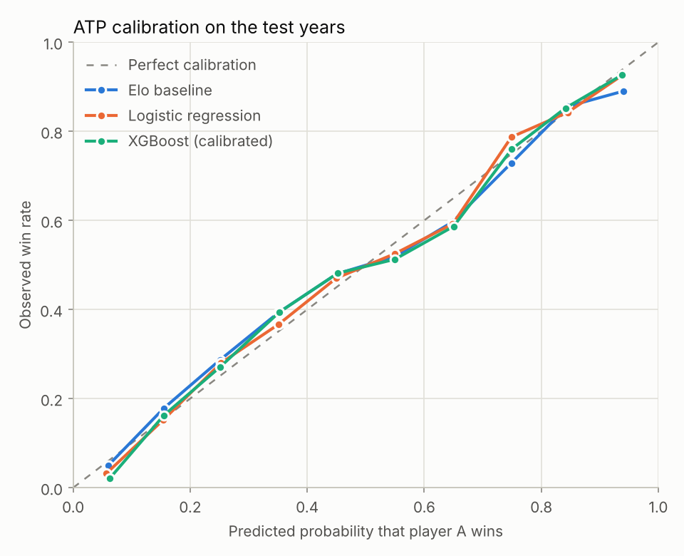
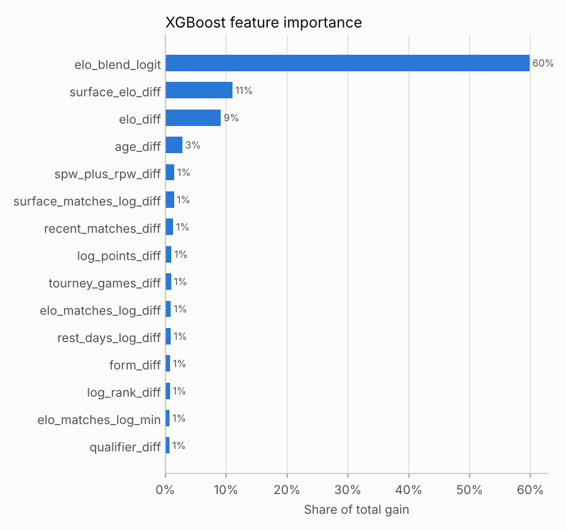
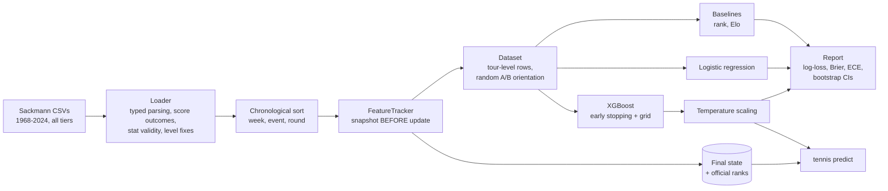

# Tennis Match Predictor

[](https://github.com/NAbobo101/tennis_db/actions/workflows/ci.yml)

[](https://github.com/astral-sh/uv)
[](https://github.com/astral-sh/ruff)

[](LICENSE)
[](data/raw/README.md)

**Leakage-free, calibrated pre-match win probabilities for ATP and WTA singles**, trained on
57 seasons (1968-2024, ~1.65 million matches) of [Jeff Sackmann's tennis data](data/raw/README.md).

> 🇧🇷 [Leia em português](README.pt-BR.md)

```console
$ uv run tennis predict "Sinner" "Alcaraz" --surface clay --event grand-slam --round F
  Jannik Sinner vs Carlos Alcaraz - Clay, best of 5
┏━━━━━━━━━━━━━━━━┳━━━━━━━┳━━━━━━━━━━┓
┃ Player         ┃ Model ┃ Elo only ┃
┡━━━━━━━━━━━━━━━━╇━━━━━━━╇━━━━━━━━━━┩
│ Jannik Sinner  │ 50.6% │    52.7% │
│ Carlos Alcaraz │ 49.4% │    47.3% │
└────────────────┴───────┴──────────┘
Favourite: Jannik Sinner. Main factors for Jannik Sinner: elo_diff (+0.17),
form_diff (-0.11), elo_blend_logit (+0.10), surface_elo_diff (-0.08), age_diff (-0.07)
State as of 2024-12-16 (data cutoff 2024-12-16).
```

## Highlights

- **Leakage-free by construction.** A sequential feature tracker computes every feature *before*
  the match result is applied, and the same code serves live predictions. The guarantees are
  checked by tests that flip results, scramble the future and cut history mid-tournament.
- **Honest evaluation.** The data is split by time: train up to 2020, validate on 2021-2022,
  test on 2023-2024. Log-loss is the main metric. Every model is compared against
  ranking and Elo baselines, with paired-bootstrap confidence intervals.
- **Domain-aware features.** The model uses 37 features:
  - surface-blended Elo, adjusted for best-of-five matches;
  - nine time-decayed serve/return rates, shrunk towards the tour mean;
  - form, head-to-head, rest and in-tournament fatigue;
  - official ranks.

  Challengers, Futures and ITF events feed the ratings.
- **Calibrated and symmetric.** `p(A beats B) + p(B beats A) = 1` holds exactly. The expected
  calibration error is ≤ 0.03.
- **Production-grade engineering:**
  - a typed `src/` package with a CLI;
  - pydantic configs, pickle-free artifacts and `mypy --strict`;
  - 200+ tests on synthetic data at 98% coverage, with CI on Python 3.12-3.14.

## Results

Test years 2023-2024. The rows are completed tour-level main-draw matches; walkovers and
retirements are excluded. The validation years were used for early stopping, model selection
and calibration. The test years were used once, for this table.

| Model | ATP log-loss ↓ | ATP accuracy | WTA log-loss ↓ | WTA accuracy |
|---|---:|---:|---:|---:|
| Rank baseline (log-rank logistic) | 0.6282 | 63.8% | 0.6312 | 63.8% |
| Elo baseline (surface blend) | 0.6045 | 65.6% | 0.5991 | 66.3% |
| Logistic regression | **0.5915** | **66.6%** | 0.5918 | **67.7%** |
| XGBoost (calibrated) | 0.5949 | 65.8% | **0.5916** | 67.4% |
| *matches* | *5,355* | | *4,916* | |

What the numbers say:

- **Both learned models beat a well-tuned Elo.** The gains are 0.007-0.013 in log-loss, and
  every 95% bootstrap interval excludes zero.
- **On ATP, the regularized logistic regression is significantly better than XGBoost.** The
  log-loss difference is +0.0034 [+0.0016, +0.0054]. On WTA the two are tied. Once the features
  carry the signal (the three Elo features account for ~80% of XGBoost's gain), gradient
  boosting adds nothing a linear model can't capture. The served model was chosen on validation, where the
  two were tied, and the report says so.
- **Grand Slams are more predictable.** In ATP best-of-five matches the logistic model reaches
  73.3% accuracy (log-loss 0.505), against 65.1% in best-of-three. Longer matches reduce variance.
- **These numbers are in line with the literature.** Published Elo models reach ~64-70% and
  bookmaker odds ~69-72%, depending on the sample ([Kovalchik 2016][kovalchik]). Accuracy well
  above 70% on *all* tour-level matches is a red flag for leakage.

Full reports, with breakdowns by surface, level and format, are in
[`reports/atp/metrics.md`](reports/atp/metrics.md) and [`reports/wta/metrics.md`](reports/wta/metrics.md).

<p>
<picture>
  <source media="(prefers-color-scheme: dark)" srcset="reports/atp/figures/reliability_dark.png">
  
</picture>
<picture>
  <source media="(prefers-color-scheme: dark)" srcset="reports/atp/figures/feature_importance_dark.png">
  
</picture>
</p>

## From 67% to an honest 66%

The project started as a single script, `super_ia.py`. It reported **66.7% (ATP) and 67.5% (WTA)**
accuracy, and the number was wrong:

| Defect in the prototype | Effect |
|---|---|
| The match's own serve statistics were appended to the rolling average *before* it became that match's feature | Target leakage |
| `train_test_split` shuffled 2000-2023 at random, after mirroring each match | It trained on the future, and a test match's mirror image sat in the training set |
| Yearly files were not sorted (recent events are stored final-first) | "Rolling form" partly contained later matches |
| `bp_saved = bpSaved / max(bpSaved, 1)` | The feature was always 0 or 1; it should divide by `bpFaced` |
| Players were keyed by name | Namesakes were merged ("Martin Landaluce" has two ids) |

With the same seven features computed from earlier matches only and evaluated on later years,
the prototype scores **60.4% (ATP) and 62.8% (WTA)**. That is *below* the 63.8% of simply
picking the better-ranked player. The rewrite rebuilt the pipeline around making that
impossible to get wrong, then added the features that actually carry signal. The full audit is
in [docs/methodology.md](docs/methodology.md#the-prototype-audit).

## Quickstart

Requirements: [uv](https://docs.astral.sh/uv/getting-started/installation/). It installs Python
3.12+ for you if needed. The match data is already vendored in `data/raw/`.

```bash
git clone https://github.com/NAbobo101/tennis_db.git
cd tennis_db
uv sync                 # create .venv with the locked dependencies
make reproduce          # train + evaluate ATP and WTA (~3 minutes), writes models/ and reports/
```

Then ask questions:

```bash
uv run tennis predict "Swiatek" "Sabalenka" --tour wta --surface clay --event masters
uv run tennis predict "Djokovic" "Alcaraz" --surface grass --event grand-slam --json
uv run tennis players search "zverev"
uv run tennis ratings --surface clay --top 10
```

| Command | Purpose |
|---|---|
| `tennis train -c configs/atp.yaml` | Build features, fit all models, save artifacts and the report |
| `tennis evaluate -c configs/atp.yaml` | Regenerate the report from saved predictions |
| `tennis predict A B [--tour --surface --event --round --best-of --as-of --json]` | Calibrated win probability, the Elo-only probability and the main factors (TreeSHAP) |
| `tennis players search NAME` | Fuzzy player lookup (accent and typo tolerant) |
| `tennis ratings [--surface]` | Elo leaderboard at the data cutoff |
| `tennis data download` | Re-download the raw data from the upstream repositories |

Names are resolved conservatively:

- "Sinner" means Jannik, because Martin Sinner last played in 2009.
- "Nadal" means Rafael, not Joan Nadal Vives with a dozen matches.
- Two comparable namesakes are listed with their ids instead of guessed.

## How it works



1. **Data.** All singles tiers are loaded: main tour, qualifying, Challengers, Futures and ITF
   (~917k ATP and ~741k WTA matches). Scores are parsed into outcomes; walkovers and retirements
   are detected, including unmarked ones. Statistics are accepted only when they are internally
   consistent. Level codes that drift between seasons are normalized.
2. **Features.** One chronological pass over the history. For each match, the tracker returns a
   *snapshot* of both players and only then applies the result. Matches of the same round of an
   event are treated as simultaneous, because upstream round-robin numbering is not chronological.
3. **Models.** A rank baseline, an Elo baseline, an L2 logistic regression (exactly symmetric:
   antisymmetric features, no intercept) and XGBoost:
   - trained on player-swapped augmented data;
   - predictions averaged over both player orders;
   - temperature-scaled on validation.
4. **Serving.** The tracker state at the data cutoff, refreshed with the official ranking list,
   is saved as parquet next to the XGBoost model (`.ubj`). No pickle is used anywhere.

Details, the feature table and design decisions are in [docs/methodology.md](docs/methodology.md),
and intended use and limitations are in the [model card](MODEL_CARD.md).

## Project structure

```text
├── configs/                  # one YAML per tour (validated by pydantic)
├── data/raw/                 # vendored Sackmann data (CC BY-NC-SA 4.0), see its README
├── docs/methodology.md       # design, features, evaluation protocol, prototype audit
├── reports/{atp,wta}/        # committed evaluation reports and figures
├── src/tennis_predictor/
│   ├── data/                 # schema, score parsing, loader, rankings, downloader
│   ├── features/             # Elo, feature registry, FeatureTracker, dataset builder
│   ├── modeling/             # baselines, training, calibration, artifacts
│   ├── evaluation/           # metrics, bootstrap, report and figures
│   ├── players.py            # name resolution
│   ├── predict.py            # Predictor (serving)
│   ├── pipeline.py           # train / evaluate orchestration
│   └── cli.py                # `tennis` command
└── tests/                    # synthetic Sackmann-format data + 200+ tests
```

## Development

```bash
make install     # uv sync + pre-commit hooks
make check       # ruff, ruff format --check, mypy --strict, pytest with coverage
make test-slow   # integration tests on the full vendored dataset
```

- CI runs lint, types and tests on every push and pull request (Python 3.12, 3.13 and 3.14).
  It uses a sparse checkout, so the 835 MB of data is never downloaded there.
- The test suite runs on generated files in the exact upstream format. They include round
  robins, team cups, walkovers with fake statistics, final-first files and unranked players.
- The leakage tests were mutation-checked: they fail on the version of the code that still had
  the round-robin leak.

See [CONTRIBUTING.md](CONTRIBUTING.md) for conventions.

## Limitations

- Upstream dates are tournament Mondays, not match days. Rest and fatigue are therefore measured
  in tournaments and games, not hours.
- No betting odds are used. Bookmakers remain ~2-4 points of accuracy ahead, and this is not a
  betting tool (see the [model card](MODEL_CARD.md)).
- The data ends in December 2024. Predictions describe players as of the data cutoff.
- The Match Charting Project data is vendored but unused. Its coverage of tour matches is
  2-21% and biased towards big matches.

## License and attribution

- **Code:** [MIT](LICENSE).
- **Data:** *Tennis databases, files, and algorithms* by
  [Jeff Sackmann / Tennis Abstract](http://www.tennisabstract.com/), licensed under
  [CC BY-NC-SA 4.0](http://creativecommons.org/licenses/by-nc-sa/4.0/). Trained models and
  reports are derived from it and inherit the license (non-commercial, share-alike).

## References

- Kovalchik, S. (2016). [Searching for the GOAT of tennis win prediction][kovalchik]. *JQAS* 12(3).
- Sipko, M. & Knottenbelt, W. (2015). [Machine Learning for the Prediction of Professional Tennis Matches](https://www.doc.ic.ac.uk/teaching/distinguished-projects/2015/m.sipko.pdf). Imperial College London.
- Sackmann, J. (2019). [An Introduction to Tennis Elo](https://www.tennisabstract.com/blog/2019/12/03/an-introduction-to-tennis-elo/).
- Wilkens, S. (2021). [Sports prediction and betting models in the machine learning age: the case of tennis](https://doi.org/10.3233/JSA-200463). *J. Sports Analytics* 7(2).
- Guo, C. et al. (2017). [On Calibration of Modern Neural Networks](https://arxiv.org/abs/1706.04599) (temperature scaling).
- Lundberg, S. et al. (2020). [From local explanations to global understanding with explainable AI for trees](https://doi.org/10.1038/s42256-019-0138-9) (TreeSHAP).

[kovalchik]: https://doi.org/10.1515/jqas-2015-0059
