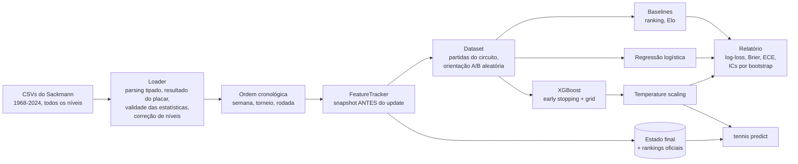

# Previsor de Partidas de Tênis

[](https://github.com/NAbobo101/tennis_db/actions/workflows/ci.yml)

[](https://github.com/astral-sh/uv)
[](https://github.com/astral-sh/ruff)

[](LICENSE)
[](data/raw/README.md)

**Probabilidades calibradas e sem vazamento de dados para partidas de simples da ATP e da WTA**,
treinadas com 57 temporadas (1968-2024, ~1,66 milhão de partidas) dos
[dados de tênis de Jeff Sackmann](data/raw/README.md).

> 🇺🇸 [Read in English](README.md)

```console
$ uv run tennis predict "Sinner" "Alcaraz" --surface clay --event grand-slam --round F
  Jannik Sinner vs Carlos Alcaraz -
           Clay, best of 5
┏━━━━━━━━━━━━━━━━┳━━━━━━━┳━━━━━━━━━━┓
┃ Player         ┃ Model ┃ Elo only ┃
┡━━━━━━━━━━━━━━━━╇━━━━━━━╇━━━━━━━━━━┩
│ Jannik Sinner  │ 50.6% │    52.7% │
│ Carlos Alcaraz │ 49.4% │    47.3% │
└────────────────┴───────┴──────────┘
Favourite: Jannik Sinner. Main factors for Jannik Sinner: elo_diff (+0.17),
form_diff (-0.11), elo_blend_logit (+0.10), surface_elo_diff (-0.08), age_diff
(-0.07)
State as of 2024-12-16 (data cutoff 2024-12-16).
```

## Destaques

- **Sem vazamento por construção.** Um rastreador sequencial calcula cada feature *antes* de
  aplicar o resultado da partida, e o mesmo código serve as previsões. Testes verificam isso
  invertendo resultados, embaralhando o futuro e cortando o histórico no meio de torneios.
- **Avaliação honesta.** A divisão é temporal: treino até 2020, validação em 2021-2022 e teste
  em 2023-2024. A métrica principal é o log-loss. Todo modelo é comparado com baselines de
  ranking e Elo, com intervalos de confiança por bootstrap pareado.
- **Features do domínio.** São 37 features:
  - Elo combinado com superfície e ajustado para melhor de cinco sets;
  - nove taxas de saque e devolução com decaimento temporal e encolhimento para a média do
    circuito;
  - forma, confronto direto, descanso e desgaste dentro do torneio;
  - rankings oficiais.

  Challengers, Futures e ITF alimentam os ratings.
- **Calibrado e simétrico.** `p(A vence B) + p(B vence A) = 1` vale exatamente. O erro de
  calibração esperado de todos os modelos é ≤ 0,032 (0,031 no modelo ATP servido).
- **Engenharia de produção:**
  - pacote tipado em `src/` com CLI;
  - configs pydantic, artefatos sem pickle e `mypy --strict`;
  - mais de 200 testes em dados sintéticos com 98% de cobertura, e CI em Python 3.12-3.14.

## Resultados

Anos de teste 2023-2024. As linhas são partidas concluídas de chave principal do circuito; W.O.
e abandonos ficam de fora. Os anos de validação foram usados para early stopping, seleção de
modelo e calibração. Os anos de teste foram usados uma única vez, para esta tabela.

| Modelo | ATP log-loss ↓ | ATP acurácia | WTA log-loss ↓ | WTA acurácia |
|---|---:|---:|---:|---:|
| Baseline de ranking (logística do log-ranking) | 0,6282 | 63,8% | 0,6312 | 63,8% |
| Baseline Elo (combinação com superfície) | 0,6045 | 65,6% | 0,5991 | 66,3% |
| Regressão logística | **0,5915** | **66,6%** | 0,5918 | **67,7%** |
| XGBoost (calibrado) | 0,5949 | 65,8% | **0,5916** | 67,4% |
| *partidas* | *5.355* | | *4.916* | |

O que os números mostram:

- **Os dois modelos aprendidos superam um baseline Elo forte.** O ganho é de 0,007-0,013 em
  log-loss, e todo intervalo de 95% do bootstrap exclui o zero.
- **Na ATP, a regressão logística regularizada é significativamente melhor que o XGBoost.** A
  diferença de log-loss é +0,0034 [+0,0016, +0,0054]. Na WTA os dois empatam. Quando as
  features já carregam o sinal (as três features de Elo respondem por ~80% do ganho do XGBoost
  na ATP e ~84% na WTA), o gradient boosting não acrescenta nada que um modelo linear não
  capture. O modelo servido é o XGBoost; na validação os dois empataram (log-loss 0,5900 vs
  0,5906 na ATP, 0,5920 vs 0,5920 na WTA), como mostra a tabela de validação do relatório.
- **Grand Slams são mais previsíveis.** Em partidas de melhor de cinco sets da ATP, a regressão
  logística chega a 73,3% de acurácia (log-loss 0,505), contra 65,1% em melhor de três.
  Partidas mais longas reduzem a variância.
- **Os números batem com a literatura.** Modelos Elo publicados chegam a ~64-70% e as odds de
  casas de apostas a ~69-74%, dependendo da amostra: 70% e 72% em [Kovalchik 2016][kovalchik]
  na ATP de 2014, com números menores para o Elo em estudos posteriores. Acurácia muito acima de
  70% em *todas* as partidas do circuito é sinal de vazamento.

Os relatórios completos, com recortes por superfície, nível e formato, estão em
[`reports/atp/metrics.md`](reports/atp/metrics.md) e [`reports/wta/metrics.md`](reports/wta/metrics.md).

<p>
<picture>
  <source media="(prefers-color-scheme: dark)" srcset="reports/atp/figures/reliability_dark.png">
  
</picture>
<picture>
  <source media="(prefers-color-scheme: dark)" srcset="reports/atp/figures/feature_importance_dark.png">
  
</picture>
</p>

## De 67% para 66% honestos

O projeto começou como um único script, `super_ia.py`. Ele reportava **66,7% (ATP) e 67,5% (WTA)**
de acurácia, e o número estava errado:

| Defeito no protótipo | Efeito |
|---|---|
| As estatísticas de saque da própria partida entravam na média móvel *antes* de ela virar a feature dessa partida | Vazamento do alvo |
| `train_test_split` embaralhava 2000-2023 aleatoriamente, depois de espelhar cada partida | Treinava com o futuro, e o espelho de uma partida de teste ficava no treino |
| Os arquivos anuais não estavam ordenados (eventos recentes vêm da final para a primeira rodada) | A "forma recente" incluía, em parte, partidas posteriores |
| `bp_saved = bpSaved / max(bpSaved, 1)` | A feature valia sempre 0 ou 1; o divisor correto é `bpFaced` |
| Jogadores identificados pelo nome | Homônimos fundidos ("Martin Landaluce" tem dois ids) |

Com as mesmas sete features calculadas só a partir de partidas anteriores e avaliadas em anos
posteriores, o protótipo marca **60,4% (ATP) e 62,8% (WTA)**. Isso fica *abaixo* de apenas
escolher o jogador mais bem ranqueado nas mesmas partidas (63,2% e 64,6%). A reescrita reconstruiu o pipeline para
tornar esse erro impossível e depois acrescentou as features que realmente têm sinal. A
auditoria completa está em [docs/methodology.md](docs/methodology.md#the-prototype-audit).

## Início rápido

Requisito: [uv](https://docs.astral.sh/uv/getting-started/installation/). Ele instala o Python
3.12+ se necessário. Os dados das partidas já vêm no repositório, em `data/raw/`.

```bash
git clone https://github.com/NAbobo101/tennis_db.git
cd tennis_db
uv sync                 # cria o .venv com as dependências travadas
make reproduce          # treina e avalia ATP e WTA (~3 minutos), gera models/ e reports/
```

Depois é só perguntar:

```bash
uv run tennis predict "Swiatek" "Sabalenka" --tour wta --surface clay --event masters
uv run tennis predict "Djokovic" "Alcaraz" --surface grass --event grand-slam --json
uv run tennis players search "zverev"
uv run tennis ratings --surface clay --top 10
```

| Comando | Função |
|---|---|
| `tennis train -c configs/atp.yaml` | Gera features, treina os modelos, salva artefatos e relatório |
| `tennis evaluate -c configs/atp.yaml` | Regera o relatório a partir das previsões salvas |
| `tennis predict A B [--tour --surface --event --round --best-of --as-of --json]` | Probabilidade calibrada, probabilidade só do Elo e principais fatores (TreeSHAP) |
| `tennis players search NOME` | Busca de jogadores tolerante a acentos e erros de digitação |
| `tennis ratings [--surface]` | Ranking Elo na data de corte dos dados |
| `tennis data download` | Baixa de novo os dados dos repositórios originais |

Os nomes são resolvidos com cautela:

- "Sinner" é o Jannik, porque Martin Sinner jogou pela última vez em 2009.
- "Nadal" é o Rafael, não Joan Nadal Vives, com uma dúzia de partidas.
- Dois homônimos comparáveis são listados com seus ids em vez de adivinhados.

## Como funciona



1. **Dados.** Todos os níveis de simples são carregados: circuito principal, qualifying,
   Challengers, Futures e ITF (~917 mil partidas ATP e ~741 mil WTA). O placar vira um
   resultado, e W.O. e abandonos são detectados, inclusive os não marcados. As estatísticas só
   são aceitas quando são internamente consistentes. Códigos de nível que mudam entre temporadas
   são normalizados.
2. **Features.** Uma única passada cronológica pelo histórico. Para cada partida, o rastreador
   devolve um *snapshot* dos dois jogadores e só depois aplica o resultado. Partidas da mesma
   rodada de um torneio são tratadas como simultâneas, porque a numeração original dos
   round-robins não é cronológica.
3. **Modelos.** Baseline de ranking, baseline Elo, regressão logística L2 (exatamente simétrica:
   features antissimétricas, sem intercepto) e XGBoost:
   - treinado com dados aumentados pela troca de jogadores;
   - previsões com a média das duas ordens de jogadores;
   - temperature scaling ajustado na validação.
4. **Serviço.** O estado do rastreador na data de corte, atualizado com o ranking oficial, é
   salvo em parquet junto ao modelo XGBoost (`.ubj`). Nenhum pickle é usado.

Os detalhes, a tabela de features e as decisões de projeto estão em
[docs/methodology.md](docs/methodology.md) (em inglês). Uso pretendido e limitações estão no
[model card](MODEL_CARD.md).

## Estrutura do projeto

```text
├── configs/                  # um YAML por circuito (validado com pydantic)
├── data/raw/                 # dados do Sackmann (CC BY-NC-SA 4.0), ver o README da pasta
├── docs/methodology.md       # projeto, features, protocolo de avaliação, auditoria do protótipo
├── reports/{atp,wta}/        # relatórios de avaliação e figuras versionados
├── src/tennis_predictor/
│   ├── data/                 # schema, parsing de placares, loader, rankings, download
│   ├── features/             # Elo, registro de features, FeatureTracker, dataset
│   ├── modeling/             # baselines, treino, calibração, artefatos
│   ├── evaluation/           # métricas, bootstrap, relatório e figuras
│   ├── players.py            # resolução de nomes
│   ├── predict.py            # Predictor (serviço)
│   ├── pipeline.py           # orquestração de train / evaluate
│   └── cli.py                # comando `tennis`
└── tests/                    # dados sintéticos no formato do Sackmann + 200+ testes
```

## Desenvolvimento

```bash
make install     # uv sync + hooks do pre-commit
make check       # ruff, ruff format --check, mypy --strict, pytest com cobertura
make test-slow   # testes de integração com o conjunto de dados completo
```

- A CI roda lint, tipos e testes em todo push para a `main` e em todo pull request (Python
  3.12, 3.13 e 3.14). Ela usa
  sparse checkout, então os 835 MB de dados nunca são baixados lá.
- Os testes rodam em arquivos gerados no formato exato dos originais. Eles incluem round-robins,
  copas por equipes, W.O. com estatísticas falsas, arquivos com a final primeiro e jogadores sem
  ranking.
- Os testes de vazamento passaram por teste de mutação: eles falham na versão do código que
  ainda tinha o vazamento nos round-robins.

Veja o [CONTRIBUTING.md](CONTRIBUTING.md) para as convenções.

## Limitações

- As datas originais são a segunda-feira do torneio, não o dia da partida. Por isso descanso e
  desgaste são medidos em torneios e games, não em horas.
- Não há odds de apostas. As casas de apostas seguem ~2-4 pontos de acurácia à frente, e esta
  não é uma ferramenta de apostas (ver o [model card](MODEL_CARD.md)).
- Os dados terminam em dezembro de 2024. As previsões descrevem os jogadores na data de corte.
- Os dados do Match Charting Project estão no repositório, mas não são usados. Eles cobrem só
  2-21% das partidas do circuito, com viés para os grandes jogos.

## Licença e atribuição

- **Código:** [MIT](LICENSE).
- **Dados:** *Tennis databases, files, and algorithms* de
  [Jeff Sackmann / Tennis Abstract](http://www.tennisabstract.com/), sob a licença
  [CC BY-NC-SA 4.0](http://creativecommons.org/licenses/by-nc-sa/4.0/). Os modelos treinados e
  os relatórios derivam desses dados e herdam a licença (uso não comercial, compartilhamento
  pela mesma licença).

## Referências

- Kovalchik, S. (2016). [Searching for the GOAT of tennis win prediction][kovalchik]. *JQAS* 12(3).
- Sipko, M. & Knottenbelt, W. (2015). [Machine Learning for the Prediction of Professional Tennis Matches](https://www.doc.ic.ac.uk/teaching/distinguished-projects/2015/m.sipko.pdf). Imperial College London.
- Sackmann, J. (2019). [An Introduction to Tennis Elo](https://www.tennisabstract.com/blog/2019/12/03/an-introduction-to-tennis-elo/).
- Wilkens, S. (2021). [Sports prediction and betting models in the machine learning age: the case of tennis](https://doi.org/10.3233/JSA-200463). *J. Sports Analytics* 7(2).
- Guo, C. et al. (2017). [On Calibration of Modern Neural Networks](https://arxiv.org/abs/1706.04599) (temperature scaling).
- Lundberg, S. et al. (2020). [From local explanations to global understanding with explainable AI for trees](https://doi.org/10.1038/s42256-019-0138-9) (TreeSHAP).

[kovalchik]: https://doi.org/10.1515/jqas-2015-0059
